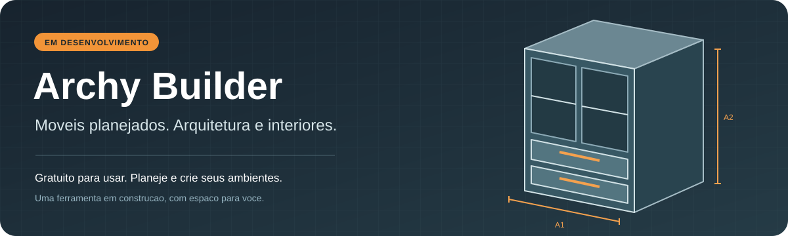

  <strong>Guia do usuario</strong> &nbsp; | &nbsp;
  <a href="docs/DEVELOPMENT.md">Desenvolvedores</a>

  

  
  

  <a href="https://github.com/IINasK/archy-builder/releases">Downloads</a> &nbsp; | &nbsp;
  <a href="#como-instalar">Como instalar</a> &nbsp; | &nbsp;
  <a href="#primeiros-passos">Primeiros passos</a> &nbsp; | &nbsp;
  <a href="https://github.com/IINasK/archy-builder/issues">Ajuda e sugestoes</a>

# Archy Builder

Uma ferramenta gratuita para **moveis planejados, marcenaria, arquitetura e
interiores no Blender**. Crie armarios, portas, gavetas e prateleiras, ajuste
medidas e organize o mobiliario nos seus ambientes.

> **Em desenvolvimento.** Algumas funcoes ainda estao sendo aprimoradas.
> Experimente em uma copia do seu projeto e mantenha seus arquivos salvos.

## O que voce pode fazer

| Recurso | Para que serve |
| --- | --- |
| **Moveis e chapas** | Montar armarios e ajustar medidas e espessuras. |
| **Portas e ferragens** | Configurar folhas, aberturas, puxadores e dobradicas. |
| **Gavetas e internos** | Criar gavetas, prateleiras, divisorias e fundos. |
| **Biblioteca** | Escolher modelos e materiais e inserir por arraste. |
| **Ambientes** | Trabalhar com paredes, piso, teto e posicionamento em vista 2D. |
| **Instalacoes** | Experimentar blocagens de esquadrias, iluminacao e eletrica em desenvolvimento. |

## Como instalar

### 1. Baixe o add-on

Abra a secao [Downloads](https://github.com/IINasK/archy-builder/releases).
Baixe **`archy_builder.zip`** na lista
de arquivos daquela versao. Esse e' o pacote pronto para instalar.

### 2. Instale o ZIP

Sem extrair o arquivo, arraste **`archy_builder.zip`** para a viewport do
Blender e confirme a instalacao.

Voce tambem pode instalar pelo menu **Edit -> Preferences -> Add-ons ->
Install from Disk**, selecionando o mesmo ZIP.

### 3. Ative o Archy Builder

Em **Preferences -> Add-ons**, procure **Archy Builder** e confira se ele
esta' ativado.

Depois de instalar ou atualizar o add-on, salve seu trabalho e reinicie o Blender.

**Versao recomendada: Blender 5.2**, para usar a biblioteca atual de modelos.
Alguns modelos salvos no Blender 5.x podem nao abrir no Blender 4.2.

## Primeiros passos

1. No seletor de tipo de editor de uma area, escolha **Archy Builder**.
2. Escolha um modelo na biblioteca e arraste para a cena.
3. Selecione o movel para ajustar as medidas e opcoes disponiveis no menu.
4. Use as abas para trabalhar com portas, gavetas, prateleiras, divisorias,
   fundos, puxadores e alvenaria.
5. Salve seu projeto normalmente no Blender.

Os controles acompanham a selecao. Um clique seleciona o conjunto; dois
cliques permitem acessar uma peca individual compativel.

## Atualizacoes

Quando uma nova versao estiver disponivel, baixe o novo **`archy_builder.zip`**
na secao Downloads e instale por cima da versao anterior. Se voce salvou
modelos proprios na biblioteca, mantenha uma copia deles antes de atualizar.

## Ajuda e sugestoes

Encontrou um problema? Abra um relato na secao
[Issues](https://github.com/IINasK/archy-builder/issues) informando:

- Versao do Blender e do Archy Builder.
- O que voce estava tentando fazer e os passos para repetir.
- O resultado esperado e o que apareceu na tela.
- Uma imagem ou arquivo pequeno de exemplo, sem dados privados de clientes.

Voce tambem pode sugerir melhorias. Veja [como enviar um relato](CONTRIBUTING.md).

## Uso gratuito

O Archy Builder e' gratuito para usar. Os avisos de licenca e de terceiros
acompanham o pacote de instalacao.

O projeto tambem e' aberto para quem deseja modifica-lo. Preparacao do
ambiente, empacotamento e contribuicoes ficam no
[guia de desenvolvimento](docs/DEVELOPMENT.md).

As instalacoes arquitetonicas ainda sao representacoes simplificadas e
precisam de verificacao tecnica para uso em um projeto executivo.
